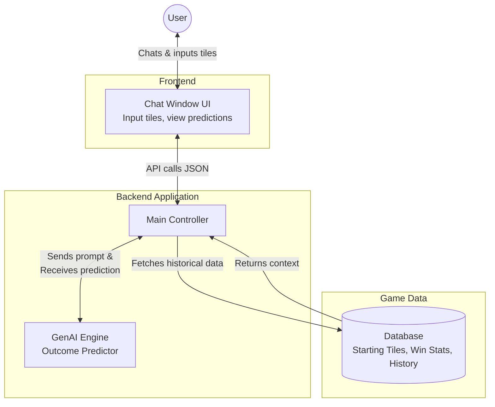
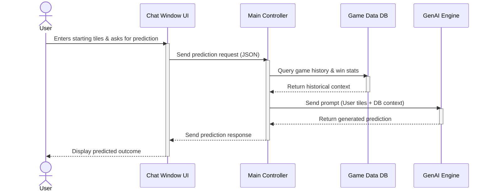
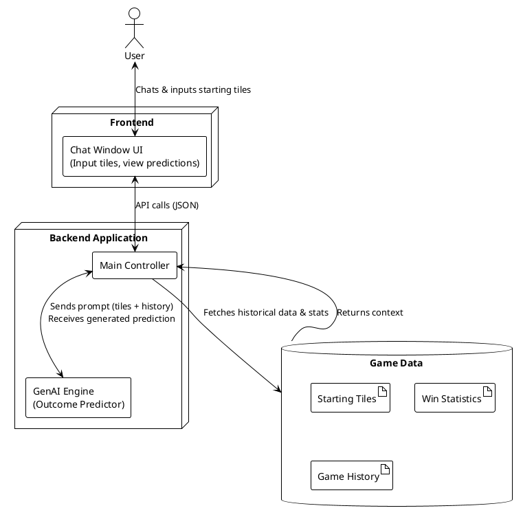
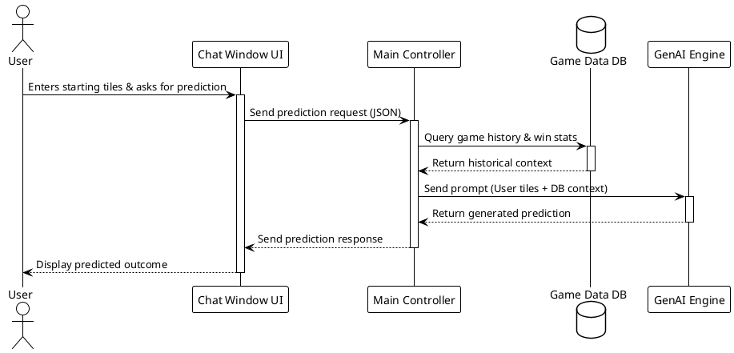

# CatanWinnerPrediction

## Project Overview
This information system is designed to demonstrate the capabilities of generative AI by predicting the winner of a "Settlers of Catan" board game based on the players' initial moves. The system takes the Kaggle Catan dataset, hides all information except for each player's two starting settlements, and asks an LLM model which player won.

## Repository Structure
* `/data/` – Directory containing the testing data (X, y pairs).
* `/prompts/` – Directory containing the testing prompts submitted to the AI agent.
* `catan_prediction.ipynb` – The source code and working system prototype, adapted for the Google Colab environment.

## UMLs

Mermaid UML

## Sequence Diagram

Mermaid Sequence Diagram

## PlantUML 

PlantUML Sequence

## Google Colab Prototype

**System Overview:** This prototype demonstrates a functioning AI system built using the Gemini API. The program reads game data, formats it into text prompts for the language model, and processes the returned winner predictions. Finally, the model's predictions are evaluated against actual winners to provide accuracy statistics.

**How to Run:**
1. Click the "Open In Colab" button above.
2. In Google Colab's left sidebar, open "Secrets" (the 🔑 icon).
3. Add your API key as a secret named `GOOGLE_API_KEY` and ensure "Notebook access" is enabled.
4. From the top menu, click **Runtime** -> **Run all** to execute the notebook and view the AI agent's performance.
